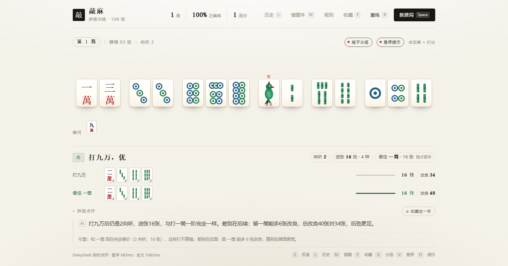
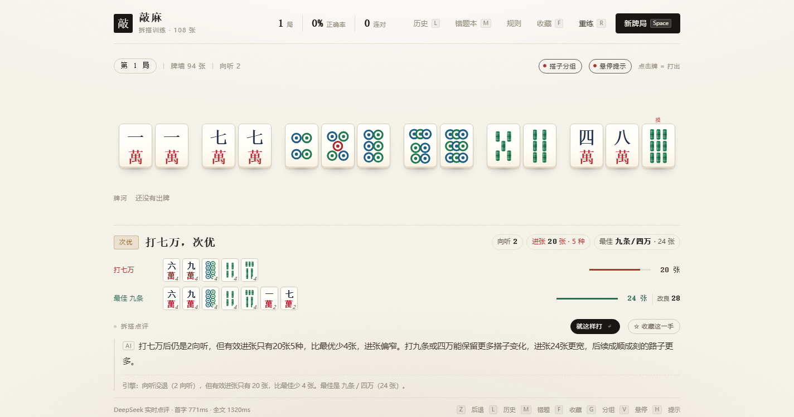
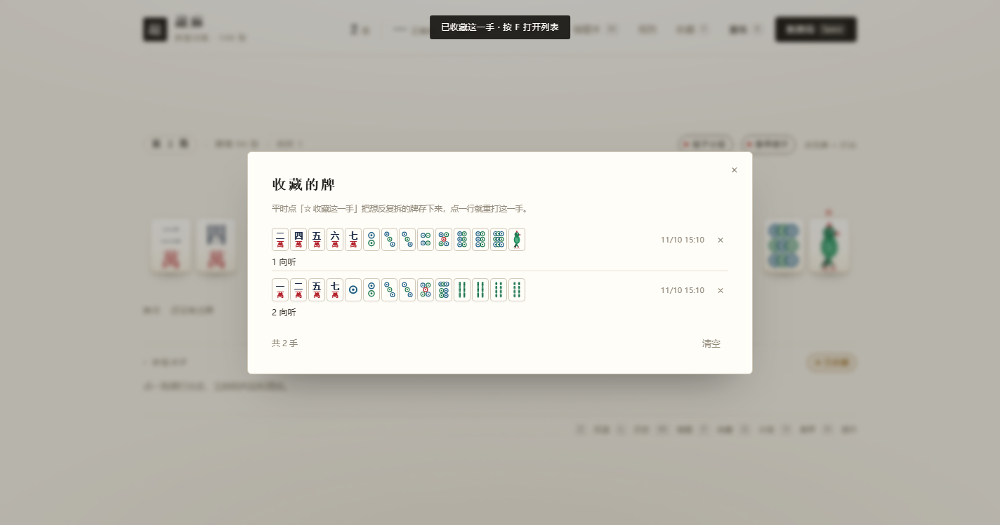
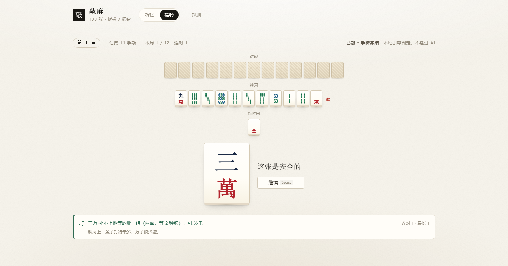
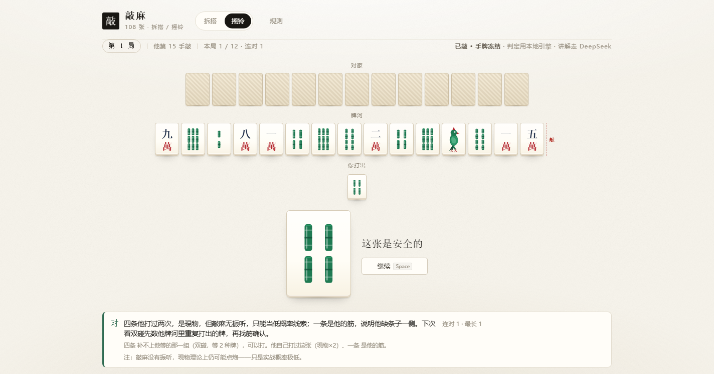

# 敲麻 · 拆搭训练器

108 张麻将（万筒条各 1-9，无字牌）的拆搭训练器。发一副手牌，点一张就代表打出去，立刻告诉你这手打得对不对、为什么，然后补一张新牌，直到胡牌。



<p align="center">
  
  


</p>

判定、算牌、拆解全部在浏览器本地跑（纯 JS 牌效引擎），点牌即出结果，不发请求、不花 token。**默认纯本地运行，不连任何模型**；想接自己的 AI 讲理由，见 [接入 AI](#接入-ai可选)。

## 启动

双击 `start.cmd`，或在本目录执行：

```
node server.mjs
```

浏览器打开 <http://127.0.0.1:8788> 。

- 判定和算牌全部在浏览器里跑（本地牌效引擎），**点击后立刻出结果**，不等网络、不花 token。
- **打对了不打扰你**：直接进牌河、摸下一张，全程零请求。
- **打错了会拦下来**：牌退回手里、不摸牌，并自动请 AI 讲这一手错在哪；你可以换一张重打，也可以「就这样打」硬着头皮继续。
- AI 只在上面这种「打错」时自动出现；打对了想追一句可以按 `A`（隐藏快捷键，不占界面）。它拿到的输入里已经写好判定和最优解，只负责讲逻辑，首字通常 0.3–0.7s。
- **默认就是纯本地**：仓库里没有 `coach.config.json`，clone 下来直接练，只跑本地引擎，不连网、不需要 key。

## 玩法

| 操作 | 作用 |
| --- | --- |
| 点牌 | 打出这张牌。打对 → 进牌河并摸新牌；打错 → 牌退回，不摸牌，弹 AI 讲解 |
| 悬停牌 | 不用打出去，先看「打它会几向听、多少进张」，和最佳差多少张 |
| `G` | 开关「搭子分组」：关掉后手牌按牌序平铺，不再按块留空隙 |
| `V` | 开关「悬停提示」：关掉后悬停只上浮牌面，不弹说明 |
| `Enter` | 打错之后「就这样打」（接受次优/退向听，照常出牌摸牌） |
| `Z` | 后退一步：回到上一张打出去之前（手牌、牌河、统计一起回滚） |
| `L` | 历史牌局：列出练过的每一局，点一行就用同一副牌重玩 |
| `M` | 错题本：打错/没打到最优的手自动收进来，点一行重打那一手 |
| `F` | 收藏：把当前这手存下来（再按一次取消），打开列表重打 |
| `A` | 让 AI 解释这一手为什么对/为什么错 |
| `Space` | 换一副新牌 |
| `R` | 重练当前这副（同 seed，可以反复拆同一手） |
| `H` | 提示：高亮当前最优的所有牌 |
| `Esc` | 关闭弹层 |

手牌自动按万→筒→条理好；刚摸进来的牌单独排在右侧、带「摸」标；鼠标悬停会抬起高亮。

历史存在浏览器 localStorage 里（`qiaoma.history.v1`），一局出过牌就记一次：第几局、出了几张、正确几手、胡没胡；点开就重玩那一副，所以「这副没打好」可以随时回去重拆。错题本存在 `qiaoma.mistakes.v1`（最多 100 手）。

## 摇铃练习

判定与讲解**全部在本地算**：`engine.mjs` 拆他的牌型（哪一组在等、等什么形、几种牌），`opponent.mjs` 用同一个最优出张器模拟他的摸打直到敲牌。**摇铃模式不调用 AI**——没有网络请求，也就没有「模型猜的」这回事。
（读牌 / 防点炮）

左上角可以在两种模式之间切：**拆搭**（判断该打哪张）与**摇铃**（判断这张会不会点炮）。

摇铃是**一局多题**的练习：对手已经敲了，牌河摆在那里，你手上一串牌，每次只拿出一张问你「打出去危不危险」。

- **对家 13 张暗牌**（已敲，手牌冻结）
- **他的牌河**：虚线「敲」之前是他敲牌前打掉的牌——只有这些能用来读牌
- **你打出**：你判断为安全的那些牌会真的进你的牌河；判断为危险的则扣下
- **只显示一张牌**：不给你看整手牌，你要读的是他的牌河，不是自己的手

| 操作 | 作用 |
|---|---|
| `1` / 点「危险」 | 这张会点炮，扣下 |
| `2` / 点「不危险」 | 这张安全，打出去 |
| `Space` | 本局结束后开下一局（答题中则跳过反馈）

三种结局：

| 情况 | 结果 |
|---|---|
| 把危险的牌打了出去（答「安全」） | **点炮**，本局结束，翻开他的 13 张并讲清他哪一组在等什么 |
| 把安全的牌当成危险（答「危险」） | **保守**，不算点炮，连对断掉，牌照样打出去，本局继续 |
| 撑过 12 张都没点炮 | 本局**逃掉**，换新的一局 |

答完**不会自动跳**，停在反馈上等你看完再按空格。答对时**不翻开他的牌、也不报他的听张**——否则后面的题全被剧透。想知道他到底在等什么，就等本局结束。

题目由 `public/readmode.js` 的 `makeRound(seed)` 生成：`simulateRound` 跑一局，取他敲牌的那一刻（牌河 + 冻结的 13 张），再从剩余牌里挑 12 张当你的牌串。

- **牌河长度不固定**：他到第几手听牌，牌河就有几张。有 `MIN_RIVER = 5` 的下限（弃牌不足 5 张的局直接跳过，否则等于让你猜），上限是 `MAX_TURNS = 16`。实测牌河 6–16 张，平均约 10 张。
- **牌串是平衡的**：一半是他的听张（危险）、一半不在听张里（安全），否则一路点「不危险」也能有八成正确率。
- **揭底会讲原因**：把他的 13 张按块拆开（面子 / 将 / 等待的那一组），等待的那组描金，文字说明形与等张，例如「他的 一条一条 是对子，只等 一筒 / 一条；一筒 正好补进这一组」。

## 自适应尺寸

页面按「视口宽度 + 视口高度」双向自适应，把窗口压成一条长条形也能完整用：

- 手牌尺寸取 `min(4.2vw, 9.5vh)`，高度不够时牌先变小，而不是撑出滚动条；
- 高度 ≤700 / ≤560 / ≤430 / ≤380px 四档，逐级收紧留白、点评高度，依次隐藏提示文案、进张牌墙、点评脚注；
- 页面是 `min-height:100dvh` 的纵向 flex，牌桌吸收多余高度，点评始终贴底，不会出现半截内容；
- 悬停说明在上方放不下时自动翻到牌的下方。

## 给新手看的三个可视化

拆搭难在「看不到块」。所以牌桌上有三件东西：

1. **搭子分组**：手牌自动按 面子 → 搭子 → 将 → 散张 理好，**块与块之间留出明显空隙**，块内紧挨着 —— 数一数有几个块、哪块最弱，一眼就够。块的具体形名（两面 / 嵌张 / 边张 / 孤张）在悬停时显示。不想要这份提示，右上角「搭子分组」开关（`G`）关掉即可，手牌退回按牌序平铺。
2. **悬停预览**：鼠标停在一张牌上，牌会抬起，并浮出「打它 → 3 向听 · 42 张 / 次优，最佳 51 张，少 9 张」，还会标出它属于什么形。零成本试错；不想看就按 `V`（或右上角「悬停提示」开关）关掉。
   注意：悬停算的是**现在这手**（已摸牌），点评面板算的是**刚才打出去的那一手**；摸牌后手牌变了，两边的最优可能不是同一个数，面板里会标注「刚才那手」。
3. **进张牌墙**：出牌后点评区列出两行真牌——「打这张能进哪些牌」和「最佳那张能进哪些牌」，右边的横条长度就是进张总张数，直接比长短。

七对路线的手牌会在向听旁标「七对路线」，此时按对子成组。


## 敲不敲：按「第几手」给建议

牌桌上方有一条提示，不看你还有几巡（牌墙剩多少你数不清），只看**你已经摸到第几手**：

```
第 6 手 · 牌墙 31 张 · 听 4 张 · 门清 1 番  [现在敲]
不敲就等于这手不和；再等一手和率少 23%
```

口径（对应你确认的番规：平胡 0 番不能和、门清 1 番最低、碰碰胡/七对 2 番、除非杠开）：

- 听牌后每多等一手，和率约掉 `k/牌墙 + 8%`（8% 按对手每手先和估）；
- 想从 1 番翻到 2 番，最多只等得起 `「(1−p−q)^m = 1/2」` 解出来的 m 手，提示条会直接给出这个上限；
- 手里有碰碰胡/七对的底子时提示「再等 ≤m 手」，并告诉你单吊哪张、还剩几张；
- 没听牌时不谈敲，只报还差几步。

## 收藏与错题本

- **收藏**（`F`）：遇到想反复拆的牌，点「☆ 收藏这一手」存进 localStorage（`qiaoma.favs.v1`，最多 100 手），按 `F` 打开列表，点一行就用当时的牌墙重打这一手。
- **错题本**（`M`）：打错或没打到最优时自动记下那 14 张牌和你的选择，列表里写着「你打 X · 应打 Y」以及差在向听还是进张，点一行就重打这一手。

判定分四档：

- **最优** —— 向听最浅、进张最多，而且同分的几手里**后续改良**最多。
- **优** —— 和最优那手现在完全等价（同向听、同进张），只是留下的牌改良少几张。**不算错**，打对了一样进牌河、摸下一张。
- **次优** —— 向听没退，但进张比最优少（面板会给出差多少张、最优打哪张）。
- **退向听** —— 打完向听变深，明显打错。

「改良」指摸到之后还能把有效进张做得更宽的那几张牌。一阶（向听 + 进张）打平时，这是唯一能分出高下的东西：比如打 A、打 B 现在都是 2 向听 20 张，但留 A 有 29 张升级牌、留 B 只有 26 张，A 就是最优，B 是优。

改良要把「摸 27 种牌、每种再找最优打」都算一遍，冷算一手约 150–300ms。所以摸完牌会在空闲里**预热**（`prewarm`），点牌时直接命中缓存，判定仍是 0–1ms。

## 为什么不用 AI 算最优解

拆搭最优解是确定性的：打哪张后「向听最浅、进张最多」，本地引擎（`engine.mjs`）穷举 14 张手牌的每一种出牌，几十微秒到十几毫秒就算完了，而且结果稳定、可复现、不花钱。

所以分工是：**引擎判定对错和最优解，AI 只负责把原因讲成人话**。请求 AI 时，把判定、最优解、向听与进张一起塞进 prompt，模型不用再推演，只组织语言——这样既快，也不会出现「89 张少于 77 张」这种自相矛盾的比较。

## 接入 AI（可选）

不接也能完整使用：判定、最优解、改良、牌墙、收藏、历史全是本地算的。AI 只是把已经算好的结论讲成一段人话，**接不接不影响对错判定**。

想接的话：

```bash
cp coach.config.example.json coach.config.json   # Windows: copy 一份再改名
```

然后填 `baseUrl` / `apiKey` / `model`，重启服务。这个文件已在 `.gitignore` 里，不会被提交。

判断是否接上：`curl http://127.0.0.1:8788/api/health` 里 `"coach": true` 就是接上了；`false` 表示没配 key，此时按 `A` 会提示去配置，不会发请求。

示例（`coach.config.json`，任一 OpenAI/Anthropic 兼容网关都行）：

```json
{
  "baseUrl": "http://127.0.0.1:3456",
  "apiKey": "...",
  "model": "deepseek-flash",
  "maxTokens": 140,
  "timeoutMs": 20000
}
```

也可用环境变量 `COACH_API_KEY` / `COACH_BASE_URL` / `COACH_MODEL` / `PORT` 覆盖。
`baseUrl` 指向任意 Anthropic 兼容的 `/v1/messages` 网关（本地网关、官方 API、自建代理都行）。

## 文件结构

```
engine.mjs              牌效引擎（纯 ESM，浏览器/Node 共用：向听、进张、听牌、判定、发牌、拆解）
server.mjs              本地静态服务 + /api/coach（转发 DeepSeek，SSE 流式）
coach.config.example.json 配置模板（复制为 coach.config.json 后填 key；后者不入库）
public/index.html       页面结构
public/style.css        样式（纸感主题：米白纸面 / 象牙牌 / 素点评面板）
public/app.js           状态机：出牌 → 判定 →（打错）AI 讲解/退回 → 摸牌 → 胡牌；含撤销、历史、错题本、收藏
public/tiles.js         牌面 SVG（万=汉字+紅萬、筒=双环、条=竹节，一条是麻雀）
test/engine.test.mjs    引擎单测（向听/进张/胡牌/性能）
test/decompose.test.mjs 拆解单测（块命名、七对、张数守恒、与向听一致）
test/features.mjs       新机制回归（打错不摸牌、撤销、历史）
test/newfeat.mjs        结构标注 / 悬停预览 / 收藏 / 错题本
test/cdp*.mjs           无 puppeteer 的 CDP 自测与截图
```

## 测试

```
node test/engine.test.mjs      # 引擎单测
node test/decompose.test.mjs   # 拆解单测：块命名、七对、与向听数一致
node test/features.mjs         # 打错不摸牌/自动 AI、打对不请求、就这样打、后退一步、历史重玩
node test/newfeat.mjs          # 结构标注、悬停预览、收藏重打、错题本重打
node test/ondemand.mjs         # 验证点牌不请求模型、按 A 才请求，并计时首字/全文
node test/clicktest.mjs        # 无头 Chrome 里点一张牌，逐帧看判定与 AI 落字
node test/verdict.mjs          # 构造「退向听」局面，检查文案与指标口径
node test/favtest.mjs          # 收藏/取消收藏、面板重打、快练已移除
node test/tiertest.mjs         # 构造「最优 / 优」同分局面，检查四档判定与改进张数
node test/shots.mjs            # 截图 shot-desktop.png / shot-mobile.png
node test/shots2.mjs           # 截图打错状态与历史面板
node test/shots3.mjs           # 截图结构标注 / 悬停预览 / 进张牌墙
node test/shots4.mjs           # 截图收藏面板与错题本
node test/shots5.mjs           # 截图「搭子分组」开 / 关 / 移动端
node test/readmode.mjs         # 摇铃模式：切换 / 发牌 / 摸打 / 敲 / 看牌 / 整局
node test/readcalib.mjs 40 500 # 读牌推断的离线校准（top-3 命中、Brier、耗时）
node test/sizetest.mjs         # 检查 9 种视口尺寸下无纵向滚动（含长条形矮窗口）
```
